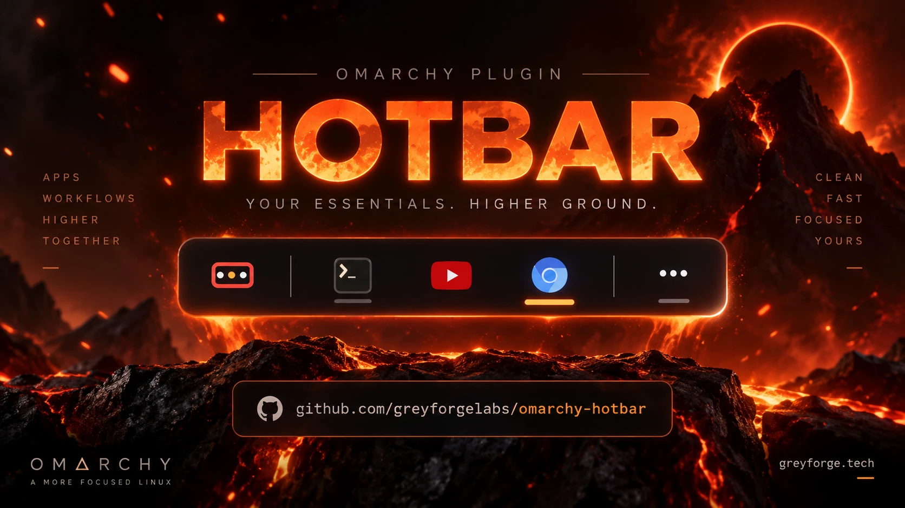
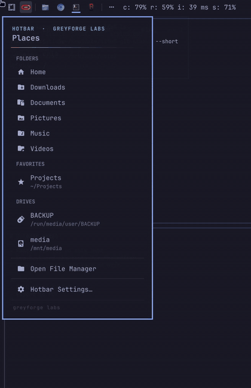
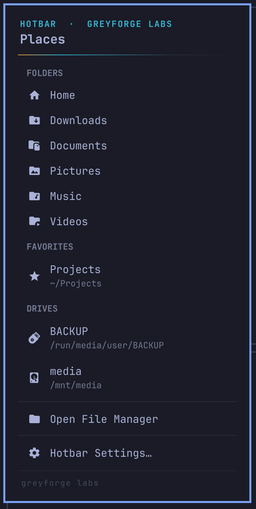
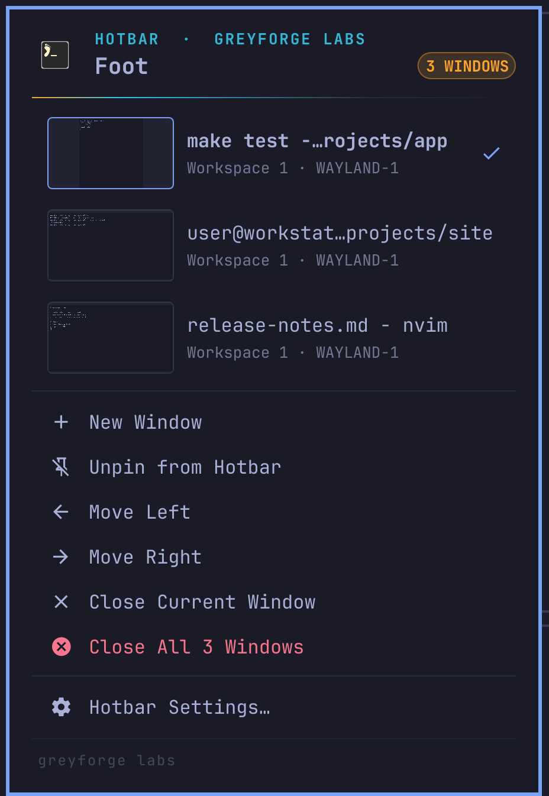
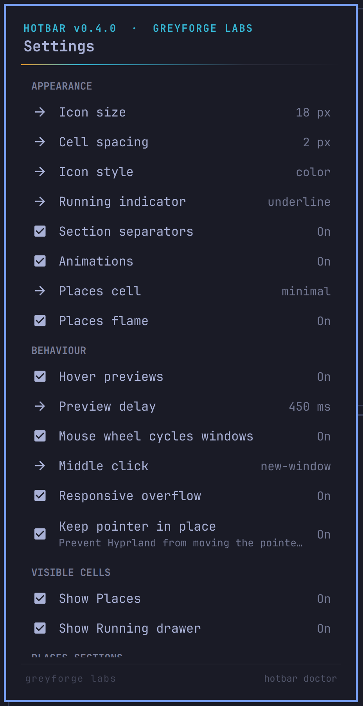

[](https://github.com/GreyforgeLabs/omarchy-hotbar/actions/workflows/test.yml)
[](https://github.com/GreyforgeLabs/omarchy-hotbar/releases/latest)
[](LICENSE)
[](https://omarchy.org)

# Hotbar

**Your bar stays put.** Hotbar is an Omarchy 4 bar plugin that gives each pinned app one fixed slot, opens your folders and drives from a Places cell, and moves everything else into one Running drawer. Open twenty windows and the bar keeps its shape.

## Install

```bash
omarchy plugin add https://github.com/GreyforgeLabs/omarchy-hotbar.git
~/.config/omarchy/plugins/greyforge.hotbar/bin/hotbar install
```

That places Hotbar after the Omarchy menu and links the `hotbar` command into `~/.local/bin`. The installer never overwrites a file it does not own. If something looks wrong afterwards, run `hotbar doctor` first.

Requires Omarchy 4.x with Hyprland in Lua-config mode (the Omarchy 4 default).

## What it does

The bar shows three things, always in the same order:

<p align="center">
  
</p>

**Places** — Home, XDG folders, favourites, mounted drives, Trash. One click opens any of them. Its cell is a small hot bar — a red pill with an amber bar and a flame shimmer; *Places cell → badge* in Settings spells out HOTBAR instead, and *Places flame* turns the shimmer off.

**Pinned apps** — the apps you chose, in the order you chose. One app gets one cell whether it has zero windows or twenty. Pins never reorder on their own.

**Running** — a single drawer holding every unpinned app plus any pin that does not fit. The bar never grows past its budget.

## Tour

<p align="center">
  
</p>

<p align="center">
  
  
</p>

The launch film, recorded with Hotbar 0.2.0:

https://github.com/user-attachments/assets/c448a696-b777-4d0d-8fa1-81cd8b216db3

Repo copy: `demo/hotbar-demo.mp4` ([blob](https://github.com/GreyforgeLabs/omarchy-hotbar/blob/master/demo/hotbar-demo.mp4) · [raw](https://github.com/GreyforgeLabs/omarchy-hotbar/raw/refs/heads/master/demo/hotbar-demo.mp4)).

## Everyday controls

| Target | Left click | Middle click | Right click | Wheel | Hover |
|---|---|---|---|---|---|
| Places | open Places | open Home | open Settings | — | tooltip |
| Pinned app | launch, focus, or cycle windows | new window | app menu | cycle windows | tooltip, then previews |
| Running | open the drawer | — | open the drawer | cycle drawer windows | tooltip |

The app menu lists every window with its workspace and monitor, plus pin/unpin, move left/right, close current, and close all. Inside any popover: arrow keys or j/k to move, Enter to open, x to close the window under the cursor, Esc to dismiss.

## Settings

<p align="center">
  
</p>

Right-click Places and pick *Hotbar Settings* — appearance, behaviour, visible cells, and Places sections are all there. Changes apply immediately and are validated before they are written. Appearance holds **Places cell** (`minimal` is a small pill with an amber bar; `badge` spells HOTBAR) and **Places flame** (the shimmer on the Places cell; needs **Animations** on). Behaviour also holds **Keep pointer in place**, which stops Hyprland moving the pointer when Hotbar focuses a window (system-wide; same as `hotbar warp off`).

The CLI covers the same settings for scripting:

```bash
hotbar set iconSize 20
hotbar set iconStyle mono
hotbar set placesStyle badge
hotbar set flame false
hotbar get previewDelay
```

## Advanced configuration

Favourites are paths, overrides name a desktop id. Neither can carry a command:

```bash
hotbar set favorites '[{"name":"Projects","path":"~/Projects"}]'
hotbar set matches '[{"name":"Discord","matchClass":"^chrome-discord\\.com.*$","desktopId":"discord"}]'
hotbar pin chromium
hotbar unpin chromium
```

`hotbar identify` shows how every open window was grouped, which is what you need to write an override.

Pinned slots are addressable for key bindings — `hotbar activate 1` opens slot 1, so you can bind Super+1..9 in your Hyprland config. With the native fast path built (below), bind `hotbar-native activateIndex 1` from the plugin's `bin/` directory instead: it reaches the widget in well under a millisecond.

Every command that takes an app (`pin`, `unpin`, `activate`, `new`, `open`) accepts a desktop id in any case (`org.gnome.nautilus`), an identity key (`class:tui.float`), or the app id or class of a running window (`tui.float`). A refused call, such as an unknown app or screen, an empty pin slot or an invalid setting, prints the reason and exits 1, so scripts can tell. `hotbar screens` lists the monitor names that `--screen` accepts.

## Native fast path

Hotbar's hot paths are available in C, behind the same commands:

```bash
cd ~/.config/omarchy/plugins/greyforge.hotbar
make native          # needs a C compiler; libc is the only dependency
hotbar doctor        # "ok   native fast path: hotbar-native reaches the widget socket"
```

- `bin/hotbar-native` talks to a Unix socket the widget serves itself
  (`$XDG_RUNTIME_DIR/greyforge.hotbar-<session>.sock`) instead of launching a
  Qt process for every call. The `hotbar` CLI uses it automatically and falls
  back to `omarchy-shell` when it is not built or the widget is not up; set
  `HOTBAR_NO_NATIVE=1` to force the portable path. A call that may have
  reached the widget is never repeated on the fallback.
- `bin/hotbar-places-native` gathers the Places data (mounts, labels, trash
  handler, folder existence) from `/proc` and `/dev/disk` directly; the widget
  uses it when present and the shell helper otherwise.
- The flame shimmer on the Places cell is a fragment shader
  (`components/shaders/flame.frag`, shipped precompiled), so it no longer
  repaints a Canvas in JavaScript on every tick.

Measured locally (medians of 40 launches, `make bench`): a full CLI command
went from about 98 ms to 7 ms; one call to the widget from 30 ms to 0.6 ms;
the Places helper from 12 ms to 0.8 ms; and the shell's CPU while the flame
shimmers dropped by about two thirds. `docs/QUALIFICATION.md` has the method.
`make clean` removes the binaries; the widget keeps working without them.

## Cursor warps (pointer jumps to center)

Omarchy enables `cursor:warp_on_change_workspace` by default, and Hyprland
warps to the window center on focus. Every Hotbar click focuses a window,
so the pointer jumps. Hotbar does not change this on its own — opt in:

```bash
hotbar warp status   # disabled or enabled?
hotbar warp off      # disable (managed block in ~/.config/hypr/looknfeel.lua)
hotbar warp on       # restore Omarchy defaults
hotbar doctor        # also reports the warp state with the fix hint
```

`warp off|on` writes one marked block, backs up the file first, and runs
`hyprctl reload`. It never touches `/usr/share/omarchy/`. The same control
is in *Hotbar Settings* as **Keep pointer in place** (ON = warps disabled),
which always shows the real Hyprland state when Settings opens.

## Compatibility and safety

Needs Omarchy 4.x with Hyprland in Lua-config mode. Hotbar has no daemon and does no background polling while idle; Places runs one short helper when it opens. The native socket is served by the widget inside the shell (no extra process), lives in the user's 0700 runtime directory, and only dispatches to the same IPC functions `omarchy-shell hotbar …` reaches. A 41-window acceptance run against the live shell keeps the bar surface byte-identical before and after — see `docs/QUALIFICATION.md`.

## Troubleshooting

Start with `hotbar doctor`. It only reads, and every line it prints names its fix.

| You see | Fix |
|---|---|
| `CONFLICT ~/.local/bin/hotbar points at …` | Another file owns the `hotbar` name. Remove it and run `hotbar install` again, or keep it and call `~/.config/omarchy/plugins/greyforge.hotbar/bin/hotbar` directly. |
| `hotbar: HOTBAR widget is not answering` or `MISSING HOTBAR IPC target` | The widget is not installed, or the shell is reloading the plugin. Run `hotbar install`, or wait a moment; if it persists, run `omarchy restart shell`. |
| `hotbar-native is built but the widget socket is not answering` | The shell still runs the previous Hotbar. Run `omarchy restart shell` after updating. |
| `~/.local/bin is not in PATH` | Add it to your `PATH`, or use the full path above. |
| The pointer jumps to the middle of a window when you click a cell | `hotbar warp off` (see [Cursor warps](#cursor-warps-pointer-jumps-to-center)). |

## Removal

```bash
hotbar uninstall
```

That removes the CLI symlink it owns, the Hotbar state mirror, and the plugin itself. Plain `omarchy plugin remove greyforge.hotbar` also removes the plugin but leaves the CLI link and state mirror behind.

## Development

```bash
make native                      # C client + C Places helper (optional fast path)
make shaders                     # recompile components/shaders/*.frag (needs qt6-shadertools)
bash tests/run.sh                # offline: models, lifecycle, retry, parity, native helpers, QML parse
make bench                       # native vs portable latency/CPU against the live widget
tests/live/acceptance.sh         # live shell: 41-window scenario, popovers, cycling
```

The offline suite runs the native tests when the binaries are built and skips
them otherwise; CI builds them.

Background reading: `docs/PLATFORM-AUDIT.md` (what the host provides), `docs/QUALIFICATION.md` (release-gate evidence), `CHANGELOG.md` (release history).

## More from Greyforge Labs

- [Reprieve](https://github.com/GreyforgeLabs/reprieve) — a safety net for Super+W: the window hides instead of closing, one keystroke brings it back.
- [CRIS](https://github.com/GreyforgeLabs/omarchy-cris) — CPU, RAM, Internet and Storage in one line of the bar, from a 16 KB process.
- [Sley](https://github.com/sley-lang/sley) — a machine-native programming language for AI agents.
- [All Greyforge Labs tools](https://greyforge.tech/open-source)

## License

MIT — Greyforge Labs.

---

<p align="center">
  <b>Bar stayed put?</b> <a href="https://github.com/GreyforgeLabs/omarchy-hotbar">Star Hotbar on GitHub</a> · <a href="https://x.com/GreyforgeLabs">Follow @GreyforgeLabs</a> · <a href="https://greyforge.tech/open-source">More Omarchy tools at greyforge.tech</a>
</p>
